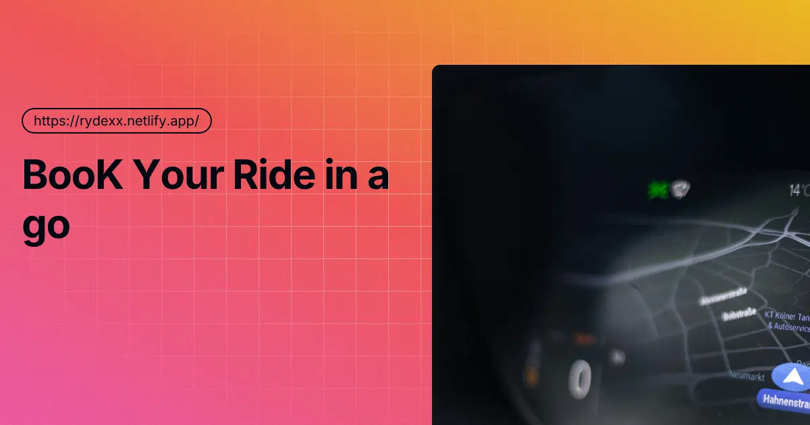
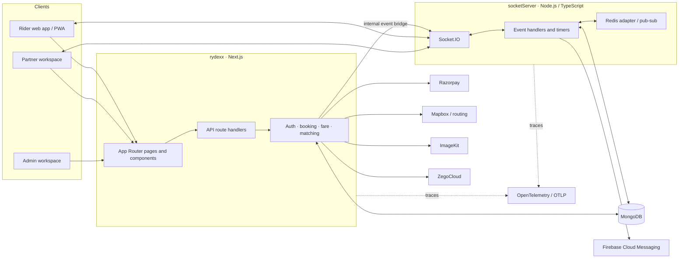
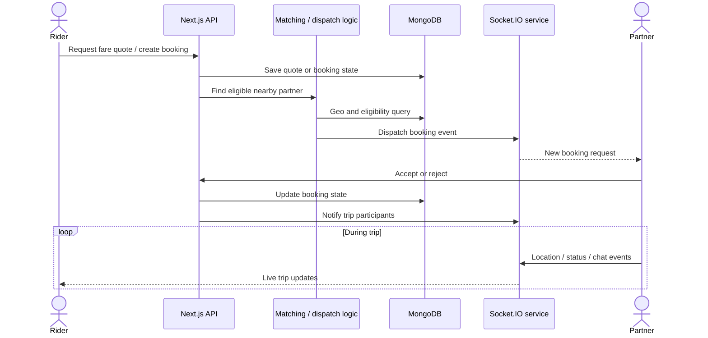
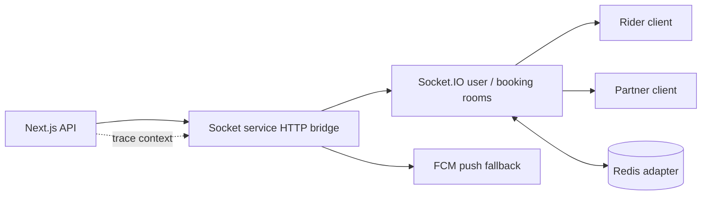

<div align="center">


# Rydex

### One platform for rides, vehicles, and local logistics

Book a ride or a vehicle, follow the trip live, and manage the whole journey from one app.

[](https://nextjs.org/)
[](https://www.typescriptlang.org/)
[](https://www.mongodb.com/)
[](https://socket.io/)
[](LICENSE)

[Live app](https://rydexx.netlify.app) · [Frontend and API](./rydexx/README.md) · [Realtime service](./socketServer/README.md)

</div>

<p align="center">
  
</p>

## At a glance

Rydex is a multi-role mobility and logistics application for **riders, driver-partners, and administrators**. It brings vehicle discovery, booking, dispatch, payment, trip operations, and fleet administration into a single web app. The product includes both conventional rides and newer flows such as prepaid smart passes and a partner pass validator.

| Area | What’s in the repo |
|---|---|
| Rider app | Account and profile, vehicle search, booking quotes, scheduled rides, live trip view, trip sharing, chat, notifications, reviews, wallet, and passes |
| Partner app | Onboarding and document review, vehicle and pricing setup, incoming requests, active ride tools, earnings, demand/recommendation views, settlements, and pass validation |
| Admin app | Booking and partner operations, vehicle review, live map and heatmap, surge zones, coupons, notifications, audit logs, analytics, and health metrics |
| Platform services | Next.js API routes, MongoDB persistence, Socket.IO events, push notifications, payment integrations, media uploads, and tracing |

## Product preview

The repository includes the app’s Open Graph artwork and landing hero asset. These are product art, not a set of captured screens.

<p align="center">
  
</p>

## Architecture

The web app owns the product UI and application APIs. The separate socket service keeps long-lived realtime connections available and can use Redis for multi-instance Socket.IO delivery.



### Main components

| Component | Location | Responsibility |
|---|---|---|
| Web application | [`rydexx/`](./rydexx/) | Next.js App Router UI, server actions/routes, authentication, product logic, and PWA assets |
| Realtime service | [`socketServer/`](./socketServer/) | Socket.IO connections, booking-room events, location/chat updates, push fallback, pass validation, and timers |
| Persistent data | MongoDB via Mongoose | User, vehicle, booking, payment-related, pass, wallet, notification, review, and operations records |
| Shared delivery/scaling | Redis and Socket.IO Redis adapter | Realtime fan-out across socket service instances and supporting service coordination |

## What’s built

### Rider experience

- Email/password and Google sign-in, email verification, and WebAuthn passkeys.
- Browse supported vehicle categories, find nearby vehicles, set pickup/drop-off, and review fare quotes.
- Create immediate or scheduled bookings; use online payment, cash, wallet, or an eligible smart pass.
- Follow a ride on the map with live partner location, booking status, OTP checkpoints, and in-ride chat.
- Share trip details through a public share route, raise an SOS, and leave a post-trip rating and review.
- Manage saved places, notifications, wallet balance/top-ups, and purchased passes.

### Driver-partner experience

- Multi-step onboarding for vehicle, documents, bank details, pricing, and video KYC.
- Receive and respond to booking requests; update ride status and verify pickup/drop OTPs.
- Broadcast location and communicate with the rider during an active trip.
- Review earnings, analytics, demand signals, recommendations, bookings, and settlements.
- Validate a rider’s smart pass through the partner validator flow.

### Admin and operations

- Review partners, vehicles, and video KYC submissions; manage users and bookings.
- Monitor live partner locations and booking heatmaps; manage surge zones.
- Review earnings and analytics, create/manage coupons, and send notifications.
- Inspect audit logs and health metrics; resolve SOS events and use operational dispatch tools.

## Booking and dispatch flow



The matching and dispatch implementation is in `rydexx/src/lib/matching/` and `rydexx/src/lib/matchmaker.ts`; booking route handlers live under `rydexx/src/app/api/booking/`. Dispatch timing and behavior are configuration-dependent, so consult those files and the socket service documentation for the current values.

## Realtime and operations

The socket service handles identity and booking rooms, partner location updates, ride chat, booking notifications, and smart-pass validation events. When a partner is offline, Firebase Cloud Messaging can deliver supported notifications. Redis and the Socket.IO Redis adapter support multi-instance event delivery. OpenTelemetry instrumentation is present in both services and can export traces to an OTLP collector such as Jaeger.



## Tech stack

| Layer | Technologies |
|---|---|
| Web | Next.js 16 App Router, React 19, TypeScript, Tailwind CSS 4 |
| UI and data | Motion, Redux Toolkit, SWR, Recharts, Lucide, Zod |
| Maps and geo | Mapbox GL, React Map GL, Mapbox Draw, Turf, routing helpers |
| Authentication | Auth.js / NextAuth v5, Google OAuth, credentials, bcrypt, SimpleWebAuthn |
| Data | MongoDB Atlas, Mongoose |
| Realtime | Socket.IO client/server, Express 5, Redis, Socket.IO Redis adapter |
| Payments and mobility services | Razorpay, Firebase Cloud Messaging, ImageKit, ZegoCloud |
| Reliability | OpenTelemetry SDK and OTLP gRPC exporter; Vitest, Testing Library, Playwright |

Versions shown here are major lines; the package manifests are the source of truth for exact ranges: [`rydexx/package.json`](./rydexx/package.json) and [`socketServer/package.json`](./socketServer/package.json).

## Repository layout

```text
.
├── readme.md
├── rydexx/
│   ├── src/app/            # Public, rider, partner, admin pages and API routes
│   ├── src/components/     # Shared and role-specific UI
│   ├── src/lib/            # Auth, matching, fares, integrations, realtime helpers
│   ├── src/models/         # Mongoose models
│   ├── src/hooks/          # Client hooks
│   ├── src/redux/          # Global client state
│   └── public/             # PWA, brand, and product artwork
└── socketServer/
    ├── index.ts            # TypeScript service entry point
    ├── src/handlers/       # Socket and Redis event handlers
    ├── src/middleware/     # Internal request/auth middleware
    ├── src/services/       # DB, Redis, notifications, timers, pass tokens, cron
    ├── models/             # Socket-facing Mongoose models
    └── tests/              # Vitest service tests
```

## Local development

### Requirements

- Node.js (use a current LTS release compatible with the installed dependencies)
- MongoDB connection
- Redis for socket-service scaling and related features
- Service credentials for the integrations you want to exercise (Mapbox, Google OAuth, Razorpay, Firebase, ImageKit, and/or ZegoCloud)

### Configure

Install the repository-level tooling first, then install each service’s dependencies:

```bash
# Repo root: installs Husky and enables the Git hooks
npm install

cd rydexx && npm install
cd ../socketServer && npm install
```

Create `rydexx/.env.local` and `socketServer/.env` from the variable names referenced in each service. Keep real credentials out of commits. Set the same strong `SOCKET_INTERNAL_SECRET` in both services; it signs short-lived socket sessions and protects internal socket emits. The socket service also needs its MongoDB URL, client origins, and port; optional integrations can be omitted when not being used.

The Husky `pre-commit` hook runs `npm run check` from the repo root. That command runs frontend lint, frontend unit tests, and socket-service unit tests. You can run the same checks manually with `npm run check`.

### Run both services

```bash
# Terminal 1
cd socketServer
npm install
npm run dev

# Terminal 2
cd rydexx
npm install
npm run dev
```

The web app runs at `http://localhost:3000`; the socket service defaults to port `8000`. Check the socket service’s `/health` route for its readiness response. Optional local tracing can be enabled by setting `OTEL_EXPORTER_OTLP_ENDPOINT` in both service environments and running an OTLP-compatible collector.

### Common scripts

| Service | Command | Purpose |
|---|---|---|
| `rydexx` | `npm run dev` | Start Next.js development server |
| `rydexx` | `npm run build` / `npm start` | Build / run production web app |
| `rydexx` | `npm run lint` | Run ESLint |
| `rydexx` | `npm run test` | Run Vitest suite |
| `rydexx` | `npm run test:e2e` | Run Playwright suite |
| `socketServer` | `npm run dev` | Start TypeScript socket service in watch mode |
| `socketServer` | `npm run build` / `npm start` | Compile / run socket service |
| `socketServer` | `npm run test` | Run Vitest suite |

## Configuration and integrations

The codebase is wired for the following external services. Add only the credentials needed for the feature being developed; environment variable names are documented in the service READMEs and referenced in source.

| Integration | Used for |
|---|---|
| MongoDB | Application and operational data |
| Redis | Realtime scaling and shared coordination |
| Mapbox | Maps, map interactions, and route visualization |
| Razorpay | Checkout, wallet top-ups, and pass purchases |
| Firebase | Browser push notifications |
| ImageKit | Image/document upload and delivery |
| ZegoCloud | Partner video KYC sessions |
| OpenTelemetry collector | Cross-service trace export |

## Testing and quality

Both services define Vitest suites. The web app also defines Playwright E2E scripts and ESLint. Test commands are listed above; test coverage and local dependency behavior are described in the service-specific READMEs.

## Deployment shape

Deploy the Next.js application and the socket service as separate processes. The socket service requires a host that supports persistent Node.js processes and WebSocket connections. The repository includes a Render service definition for `socketServer` in [`render.yaml`](./render.yaml). Configure secrets and integration URLs in the deployment environment, and ensure the web app’s configured socket URL and the socket service’s allowed client origins agree.

## Documentation

- [Frontend, API, and product implementation notes](./rydexx/README.md)
- [Socket service, events, scaling, and operations](./socketServer/README.md)
- [License](./LICENSE)

## Author

**Zuhaib Rashid** · [GitHub](https://github.com/Zuhaib-dev) · [Portfolio](https://zuhaibrashid.com) · [LinkedIn](https://www.linkedin.com/in/zuhaib-rashid-661345318/) · [X](https://x.com/xuhaib_x9)
